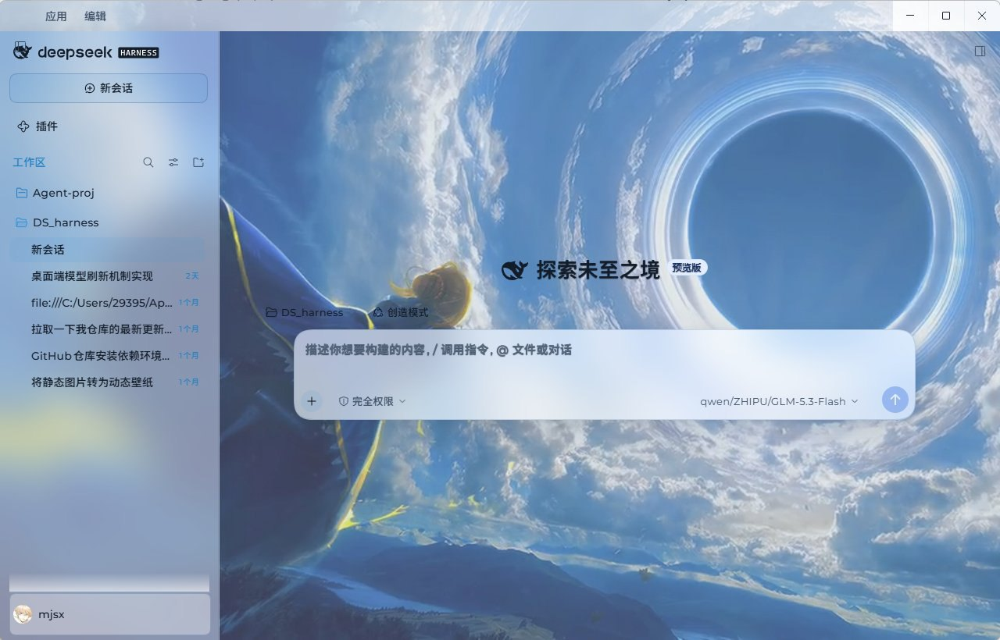
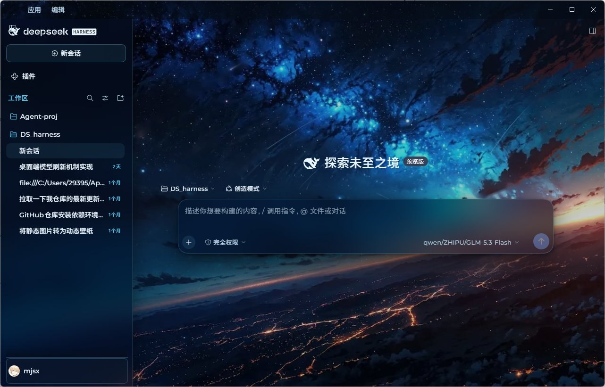
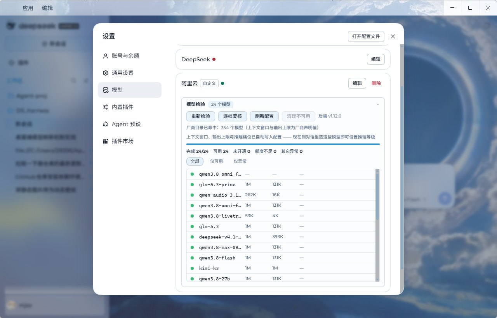

# dsh-xingkong-theme · Nebula Core (星空主题)

A theme for the DeepSeek Harness Web GUI. **Dark = deep-space observatory**,
**Light = dawn nebula** — both are fully designed palettes, not a recoloured dark theme.

## Preview

**Light · dawn nebula** — body copy is white with a soft blurred shadow so it stays readable
directly on the wallpaper; the task panel and status strip share the same pale blue:



**Dark · deep-space observatory** — the same layout and typography, not a recoloured background:



**Model probe panel (since v1.11.0)** — inside the official Settings → Models page: which
models actually answer, their real context window, and which reasoning levels the endpoint
accepts:



## Features (v1.13.0)

- **Type on a photograph, done three ways (rebuilt in v1.13.0)**: light-mode body copy is now
  white ink with a blurred dark shadow. Dark ink failed because it landed on the wallpaper's
  mid-tones at nearly the same luminance (measured ≈0.19 for both, 1.9:1–2.6:1); white reaches
  ≈4.4:1 on that same band. **Deliberately no glyph outline**: `-webkit-text-stroke` is a
  centred stroke that eats half its width inward, and a 15px CJK counter (口/日/回) is only
  about 2px across, so even a 0.55px stroke closes it up. `paint-order: stroke fill` keeps the
  fill from thinning but does nothing for the counters.
- **No more mid-blue on mid-blue (v1.13.0)**: the status strip (turns / tok/s / cache hit) and
  each message's action row (copy / like / dislike / share + timestamp) were painted in a
  tertiary mid-blue that sat on the wallpaper's dark band (measured p90 110–135) at almost the
  same value. Both are now white with a soft shadow; the SVG icons get a `drop-shadow`
  because SVG ignores `text-shadow`.
- **Dark-mode film removed (v1.13.0)**: the app root frame and the sidebar's bottom panels had
  white rules with **no light-mode prefix**, so dark mode wore a 22% white sheet over the whole
  window. They are now painted per scheme, and a general audit fails any "light background
  without the light prefix" rule so the class of bug cannot come back silently.
- **Light wallpaper graded (v1.13.0)**: the visible wallpaper layer is the **video**, not the
  JPEG (`readyState 4`; a poster only shows before the first frame arrives), so the video gets
  `brightness(0.93) contrast(1.07)`. The JPEG additionally gets a real unsharp mask plus a
  slight depth cut for the poster and the no-video fallback — measured detail up ~1.49×.

- **Model probe panel (v1.11.0)**: inside every pi-ai provider card on the official
  Settings → Models page, this theme renders a probe panel through the extension slot the app
  reserves for third-party plugins (`settings.models.provider-card`). It answers the three
  things the official page cannot: which models actually answer, their real context window and
  output cap, and which reasoning levels the endpoint accepts. Probing runs in the **host half**
  (model endpoints send no CORS headers, and the key never enters the renderer).
- **Animated nebula wallpaper**: a 24s seamless video loop, served by the host half over an
  HTTP route (with Range/206 support). Dark uses `nebula.mp4`, light uses `nebula-light.mp4`;
  static JPEGs act as poster / fallback. Keyframes every 1s, so the loop wrap decodes instantly.
- **Light is a first-class theme**: light mode has its own 4K pale-nebula wallpaper
  (procedurally generated: periwinkle sky, a cyan ionised core, magenta dense masses,
  dark dust lanes, a star field) — **not** a desaturated copy of the dark image.
- **Scheme-aware floating surfaces**: the settings dialog, menus, popovers and toasts read
  `--dshx-float-*` variables carrying real `{light,dark}` values. v1.2.0 hardcoded these to dark,
  so the dialog stayed a black slab in light mode — fixed.
- **No bleed-through on the composer**: the composer seat uses `--dsw-alias-bg-base` as an opaque
  gradient stop; with a transparent base under a wallpaper, messages showed through. Restored via
  a per-scheme variable.
- **Un-capped reading column**: the official `clamp(680px, …×0.64, 920px)` ceiling is lifted to
  `min(1180px, 100% − 96px)`.
- **Type & contrast**: 15px / 1.75 body, letter-spaced headings, soft text-shadow (a bright halo
  in light mode) so copy stays legible over the image.

## Bundle layout (same shape as official themes)

```
package.json            dsh.bundle.patch + dsh.client{platform:web,immediately}
cordis.patch.yml        insert: xingkong-theme → dsh-xingkong-theme
deploy.sh               one-shot deploy + byte verification (see below)
bundle/host.js          host half: 4 asset routes (dark/light × image/video), HTTP Range(206)
bundle/client.js        browser half: ctx.theme.overrideTokens('xingkong', {74 tokens})
                        + overrideTokens('xingkong-float', {7 float vars})
                        + animated <video> wallpaper + light/dark switching
bundle/assets/          the 4 shipped assets
source/                 authoring sources, NOT shipped (47 MB master video, etc.)
```

## Light / dark switching

The authoritative API of the official `dsh-client-ui-theme` is:

- **`ctx.theme.getTheme().active.colorScheme`** → `"light"` / `"dark"`
  (note: **not** `getTheme().colorScheme` — there is no top-level field)
- `ctx.on("theme/change", handler)` → theme-changed event
- `ctx.theme.overrideTokens(source, table)` → each table value is read per `{light, dark}`

This theme subscribes to `theme/change` first, falls back to a MutationObserver on the
boot-script signals (`data-ds-theme-source`, `data-ds-dark-theme`), and finally probes
`matchMedia`.

## Deploy (important)

The theme is a **local package** (no registry). DSH's plugin manager installs registry packages
into `.generations/<name>+<ver>+<hash>/` and then **junctions** them into
`profiles/web/node_modules/`. **Hand-copying a bare directory into `node_modules/` does nothing** —
the client-module registry ignores it and the plugin never loads (you will not even see a
`[xingkong-theme]` line in `harness.log`).

So use `deploy.sh`, which replicates the official layout:

```bash
bash deploy.sh          # deploy / update
bash deploy.sh --check  # verify only, change nothing
```

It does four things: (1) mirror into the generation dir; (2) junction it into `node_modules`;
(3) register it in `profiles/web/cordis.patch.yml` (idempotent); (4) disable any duplicate
registration in `.dsh-market/hot-*.yml` (otherwise you get
`resolves from multiple active Loader sources`). Then it verifies bytes.

Because it is a junction, **edit the source, re-run `deploy.sh`, restart DSH** to update.

### Confirming it loaded

After launch, `%APPDATA%\dsh-desktop\logs\harness.log` should contain:

```
[xingkong-theme] host half active (4/4 asset routes registered)
```

## Uninstall

Remove the `xingkong-theme` insert row from `profiles/web/cordis.patch.yml`, drop the
`node_modules/dsh-xingkong-theme` junction and its generation dir, then restart.

## Design rules (when editing)

1. **Canvas / content panels stay translucent** (so the wallpaper reads through) while
   **floating surfaces stay opaque** (so content is readable). Keep the two groups separate.
   Floating colours MUST go through `--dshx-float-*` — never hardcode them.
2. **Light panels must be more opaque than dark ones**: the light wallpaper is a colourful
   nebula, so readability has to come from the panel, not from flattening the artwork.
   Current `bg-layer-1/2/3` = .62/.70/.78.
3. Wallpaper motion uses `translate3d` only — never `scale()`, which resamples every frame and
   reads as judder.
4. Video encoding: `yuv420p` + `bt709` + limited range, `-g 30` (1s keyframes), `+faststart`.
5. Light-scheme colours must pass contrast: body text ≥ 4.5:1, secondary ≥ 3:1
   (asserted in `_test_client.js`).
6. After editing: `node --check` → `_test_client.js` → `_test_host.js` → `deploy.sh`.
